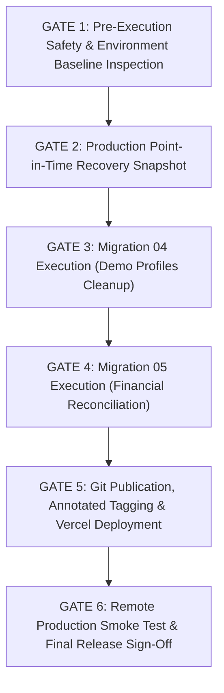

# LIEC HEAV'N — v1.5.0 PRODUCTION EXECUTION RUNBOOK
## Gate-Controlled Production Rollout Procedure

- **Project:** LIEC Heav’n — Education Management Workspace (`liec-heav-n-workspace`)
- **Target Release:** `v1.5.0`
- **Feature Branch:** `feature/priority2-enhancements`
- **Target Commit SHA:** `686417c36df6a37d10f134681552bd2ade362612`
- **Production Baseline Version:** `v1.4.1` (Commit `e7aaf7298dca6046af765016d3252afe1d6e158b`)
- **Document Classification:** Operational Runbook — Read-Only / Execution on Authorization Only
- **Production Guard:** **ZERO OPERATIONS AUTHORIZED WITHOUT EXPLICIT GATE-BY-GATE PROJECT OWNER SIGN-OFF**

---

## 1. PRODUCTION ENVIRONMENT IDENTIFICATION & ACCESS CONTROLS

The operator executing this runbook must explicitly verify environment parameters before issuing any command. Under no circumstances should this runbook be executed against unverified hosts.

| Parameter | Authoritative Production Value | Verification Method |
| :--- | :--- | :--- |
| **Production URL** | `https://workspace.liecconsulting.com` | DNS / Browser verification |
| **Neon Project Name** | `hidden-tooth-17237467` | Neon Console / CLI inspection |
| **Neon Compute Endpoint** | `ep-silent-recipe-b9ahkke2.c-7.eu-central-1.aws.neon.tech` | SQL `SELECT inet_server_addr();` |
| **Neon Production Branch** | `main` (`br-delicate-glitter-b9g66zzx`) | Neon Console / API check |
| **Neon Database Name** | `neondb` | SQL `SELECT current_database();` |
| **Vercel Project** | `liec-heav-n-workspace` | Vercel CLI / Dashboard |
| **Git Remote (`origin`)** | `https://github.com/Mapwaba/LIEC_Heav-n-workspace.git` | `git remote -v` |
| **Git Target Tag** | `v1.5.0` | `git tag -l` |

> [!CAUTION]
> **Credential Protection:** Connection strings, passwords, API tokens, and secret keys must **never** be hardcoded, logged, or checked into repository files. Access credentials via local environment variables (`process.env.DATABASE_URL`) on the authorized execution machine only.

---

## 2. RELEASE ARCHITECTURE & GATE PHASING OVERVIEW

The rollout is divided into six sequential, non-overlapping gates. Each gate requires successful completion of all prior checks and explicit Project Owner sign-off before advancing.



---

## 3. GATE 1 — PRE-EXECUTION SAFETY & MIGRATION HISTORY INSPECTION

### 3.1 Objective
Confirm production cluster identity, verify that migrations `20261122_04` and `20261122_05` have not been previously executed, and verify the presence of the exact baseline records scheduled for modification.

### 3.2 Pre-Flight SQL Assertions
Execute via a read-only query session:

```sql
-- 1. Verify Host & Database Identity
SELECT current_database(), current_user, version();

-- 2. Verify Migrations Have Not Been Previously Executed
SELECT id, created_at, actor, action, entity_ref, outcome 
FROM audit_logs 
WHERE action ILIKE '%demo profiles cleanup%' 
   OR action ILIKE '%Financial reconciliation: Workstream 1.2%';
-- EXPECTED: 0 rows returned.

-- 3. Verify Exact Target Demo Profiles Exist Before Deletion
-- Record A (Nouveau Candidat)
SELECT c.id AS candidat_id, c.ref AS c_ref, d.id AS demande_id, d.ref AS d_ref
FROM candidats c
FULL OUTER JOIN demandes d ON c.ref = '#CAN-2025-056' AND d.ref = '#DEM-2025-102'
WHERE c.id = 27 OR d.id = 42;
-- EXPECTED: Exactly 1 row linking candidat_id 27 and demande_id 42.

-- Record B (Jacky Ntoro Mapwaba) & Dependencies
SELECT c.id AS candidat_id, c.ref AS c_ref, d.id AS demande_id, d.ref AS d_ref, COUNT(psl.id) AS links_count
FROM candidats c
JOIN demandes d ON c.id = 14 AND d.id = 28
LEFT JOIN parent_student_links psl ON psl.id IN (35, 36)
GROUP BY c.id, c.ref, d.id, d.ref;
-- EXPECTED: Exactly 1 row (candidat 14, demande 28, links_count = 2).

-- 4. Verify Baseline Financial Records
SELECT id, payment_ref, candidate_ref, candidate_name, amount, status
FROM prepa_payments
WHERE id IN (3, 4, 5)
ORDER BY id;
-- EXPECTED: Exactly 3 rows:
-- ID 3: Eduard Movomobe Mover, €1,500.00, status Validated
-- ID 4: Jovani Mokomba Matumele, €1,800.00, status Validated
-- ID 5: Anaella Masiala Di-Ngoma, €1,364.95, status Validated
```

### 3.3 Gate 1 Sign-Off Checkpoint
- [ ] Database identity confirmed as `hidden-tooth-17237467`.
- [ ] Audit logs show zero previous executions of migrations 04 and 05.
- [ ] Demo records (A & B) confirmed present with exact IDs.
- [ ] Financial records (Payments 3, 4, 5) confirmed present with exact amounts.
- [ ] **Project Owner Approval Granted to Proceed to Gate 2.**

---

## 4. GATE 2 — PRODUCTION POINT-IN-TIME RECOVERY SNAPSHOT

### 4.1 Objective
Create a dedicated immutable recovery snapshot branch in Neon prior to executing any data modifications. Because the demo cleanup (Migration 04) is intentionally irreversible via SQL rollback, this snapshot is the **sole recovery point** for restoring deleted demonstration profiles in the event of an emergency abort.

### 4.2 Snapshot Creation Procedure
Via Neon Management Console or authenticated Neon CLI:

```bash
# Fork dedicated recovery snapshot branch from Production main
neon branches create \
  --project-id hidden-tooth-17237467 \
  --name pre-v1.5.0-release-snapshot \
  --parent main
```

### 4.3 Snapshot Verification
Connect to the newly created snapshot compute endpoint and capture baseline WAL location:

```sql
SELECT pg_current_wal_lsn(), NOW();
```
Record the returned LSN and timestamp in the release log.

### 4.4 Gate 2 Sign-Off Checkpoint
- [ ] Snapshot branch `pre-v1.5.0-release-snapshot` created successfully.
- [ ] Snapshot endpoint confirmed healthy and authenticated.
- [ ] Snapshot WAL LSN captured and recorded.
- [ ] **Project Owner Approval Granted to Proceed to Gate 3.**

---

## 5. GATE 3 — MIGRATION 04 EXECUTION (DEMO PROFILES CLEANUP)

### 5.1 Objective
Permanently remove synthetic demo candidate records (Record A and Record B) and their associated dependencies from `parent_student_links`, `demandes`, and `candidats`.

### 5.2 Single-Session Execution Architecture
To guarantee transactional safety and prevent cross-session locking hazards:
1. Connect using a **single dedicated `pg.Client`** directly to compute endpoint `ep-silent-recipe-b9ahkke2` (port 5432, direct mode, NOT connection pooler).
2. Apply strict session timeouts before issuing queries:
   ```sql
   SET lock_timeout = '5s';
   SET statement_timeout = '30s';
   ```
3. Execute `database/migrations/20261122_04_production_demo_profiles_cleanup.sql`.
   - The file contains its own native `BEGIN;` and `COMMIT;` blocks.
   - Any assertion failure (e.g. unexpected row count) triggers `RAISE EXCEPTION` and rolls back the entire transaction automatically.

### 5.3 Post-Migration 04 Verification SQL
```sql
-- 1. Confirm Demo Profiles Are Completely Erased
SELECT COUNT(*) AS remaining_demo_candidates
FROM candidats
WHERE id IN (14, 27) 
   OR ref IN ('#CAN-2025-043', '#CAN-2025-056')
   OR full_name ILIKE '%NOUVEAU CANDIDAT%' 
   OR full_name ILIKE '%JACKY NTORO%';
-- EXPECTED: 0

SELECT COUNT(*) AS remaining_demo_demandes
FROM demandes
WHERE id IN (28, 42)
   OR ref IN ('#DEM-2025-089', '#DEM-2025-102')
   OR full_name ILIKE '%Nouveau Candidat%' 
   OR full_name ILIKE '%Jacky Ntoro%';
-- EXPECTED: 0

SELECT COUNT(*) AS remaining_demo_links
FROM parent_student_links
WHERE id IN (35, 36)
   OR student_name ILIKE '%NOUVEAU CANDIDAT%' 
   OR student_name ILIKE '%JACKY NTORO%';
-- EXPECTED: 0

-- 2. Confirm Audit Trail Record Was Written
SELECT id, created_at, actor, action, outcome, details
FROM audit_logs
WHERE action = 'Production demo profiles cleanup executed'
ORDER BY id DESC LIMIT 1;
-- EXPECTED: Exactly 1 row with outcome = 'Succès'.
```

### 5.4 Irreversibility & Rollback Limitations
> [!WARNING]
> **IRREVERSIBLE OPERATION BY DESIGN:**
> The companion rollback file `20261122_04_rollback_production_demo_profiles_cleanup.sql` does **NOT** recreate or restore deleted synthetic records. It documents an audit log entry stating that restoration requires point-in-time recovery. If demo records must be restored, the operator must execute a cluster branch restore from the Gate 2 snapshot.

### 5.5 Gate 3 Sign-Off Checkpoint
- [ ] Migration 04 committed with zero errors.
- [ ] Exactly 0 demo records remain across `candidats`, `demandes`, and `parent_student_links`.
- [ ] Cleanup audit log verified.
- [ ] **Project Owner Approval Granted to Proceed to Gate 4.**

---

## 6. GATE 4 — MIGRATION 05 EXECUTION (FINANCIAL RECONCILIATION)

### 6.1 Objective
Reconcile pre-release PREPA financial records: cancel unverified entries for Jovani (€1,800.00) and Eduard (€1,500.00), void their receipts, insert fresh €0.00 pending placeholders for manual administrative re-entry, and preserve Anaella Masiala Di-Ngoma's genuine payment (€1,364.95) and receipt byte-for-byte.

### 6.2 Single-Session Execution Architecture
1. Re-use or initiate dedicated `pg.Client` session with:
   ```sql
   SET lock_timeout = '5s';
   SET statement_timeout = '30s';
   ```
2. Execute `database/migrations/20261122_05_production_financial_corrections.sql`.
   - Wrapped in atomic `BEGIN; ... COMMIT;`.
   - Multi-barrier validation aborts if Anaella's records are modified or if target accounts have changed.

### 6.3 Post-Migration 05 Verification SQL

```sql
-- 1. Anaella Masiala Di-Ngoma Zero-Touch Verification
SELECT id, payment_ref, candidate_ref, candidate_name, amount, status, created_at
FROM prepa_payments
WHERE id = 5;
-- EXPECTED:
-- id = 5, payment_ref = 'PAY-2025-005', candidate_ref = 'CAN-2025-001',
-- candidate_name = 'ANAELLA MASIALA DI-NGOMA', amount = 1364.95, status = 'VALIDATED',
-- created_at = '2026-11-21 13:38:14.475+00'

SELECT id, receipt_number, payment_id, candidate_ref, amount_paid, verification_ref, metadata, generated_at
FROM prepa_receipts
WHERE id = 5;
-- EXPECTED:
-- id = 5, receipt_number = 'REC-2025-005', payment_id = 5, candidate_ref = 'CAN-2025-001',
-- amount_paid = 1364.95, verification_ref = 'VERIF-005', metadata = '{}'::jsonb,
-- generated_at = '2026-11-21 13:38:14.475+00'

-- 2. Eduard & Jovani Reversal Verification
SELECT id, payment_ref, amount, status, notes
FROM prepa_payments
WHERE id IN (3, 4)
ORDER BY id;
-- EXPECTED: Both status = 'CANCELLED', notes containing 'Reversed unverified test entry per Priority 2 Directive'.

SELECT id, payment_id, (metadata->>'voided')::boolean AS is_voided, metadata->>'void_reason' AS void_reason
FROM prepa_receipts
WHERE payment_id IN (3, 4)
ORDER BY payment_id;
-- EXPECTED: Both is_voided = TRUE, reason containing 'Reversed unverified test entry per Priority 2 Directive'.

-- 3. Fresh Re-entry Placeholders Verification
SELECT payment_ref, candidate_ref, amount, status, notes
FROM prepa_payments
WHERE payment_ref IN ('PAY-2025-JOV-REENTRY', 'PAY-2025-EDU-REENTRY')
ORDER BY payment_ref;
-- EXPECTED: Exactly 2 rows, amount = 0.00, status = 'PENDING'.

-- 4. Audit Log Execution Marker Verification
SELECT id, actor, action, entity_ref, outcome, details
FROM audit_logs
WHERE action = 'Financial reconciliation: Workstream 1.2'
ORDER BY id DESC LIMIT 1;
-- EXPECTED: Exactly 1 row with outcome = 'Succès' preserving Anaella Masiala Di-Ngoma.
```

### 6.4 Cohort Financial Position Verification
Execute `database/cohort_financial_reconciliation.sql` to confirm authoritative financial metrics:
- **Total Cohort Obligations:** €26,300.00
- **Genuine Validated Payments:** €1,364.95 (Anaella ONLY)
- **Total Outstanding Balance:** €24,935.05
- **Unaccounted Discrepancy:** €0.00

### 6.5 Financial Rollback Behavior & Fail-Closed Guardrails
If rollback is triggered (`20261122_05_rollback_production_financial_corrections.sql`):
- The rollback script contains 8 fail-closed guardrails.
- It will **ABORT immediately** without making any changes if:
  1. Anaella's receipt or payment has been altered, duplicated, or deleted.
  2. Any payment was updated after migration with a timestamp advancing past the migration marker.
  3. Any baseline payment attributes on payments 3 or 4 were tampered with.
  4. More than one migration marker exists in `audit_logs`.
- If rollback aborts, manual inspection or snapshot restoration is mandatory.

### 6.6 Gate 4 Sign-Off Checkpoint
- [ ] Migration 05 committed with zero errors.
- [ ] Anaella's payment (ID 5) and receipt (ID 5) verified 100% untouched.
- [ ] Payments 3 and 4 confirmed CANCELLED; receipts 3 and 4 confirmed voided.
- [ ] Fresh re-entry instalments confirmed at €0.00 pending.
- [ ] 12-student ledger confirms €1,364.95 genuine revenue and €24,935.05 balance.
- [ ] **Project Owner Approval Granted to Proceed to Gate 5.**

---

## 7. GATE 5 — GIT MERGE, TAGGING & VERCEL DEPLOYMENT

### 7.1 Objective
Merge feature branch into `main`, generate official release tag `v1.5.0`, push atomically to GitHub, and verify Vercel production compilation.

### 7.2 Execution Commands

```powershell
Set-Location "C:\Users\barth\.gemini\antigravity\scratch\LIEC_Heav-n-workspace"

# 1. Switch to main and pull latest remote baseline
git checkout main
git pull origin main

# 2. Fast-forward merge feature branch
git merge --ff-only feature/priority2-enhancements

# 3. Create Annotated Release Tag
git tag -a v1.5.0 -m "LIEC Heav'n Release v1.5.0: Production Safety, Demo Cleanup, Financial Reconciliation, TrustAVI Catalog & Presence Sync"

# 4. Atomic Push to GitHub Remote
git push --atomic origin main refs/tags/v1.5.0
```

### 7.3 Vercel Deployment Monitoring
1. Monitor Vercel deployment pipeline:
   - Verify deployment is triggered from commit SHA matching `refs/tags/v1.5.0`.
   - Verify build completes with code `0`.
   - Verify production alias `https://workspace.liecconsulting.com` points to the new deployment.

### 7.4 Gate 5 Sign-Off Checkpoint
- [ ] Git fast-forward merge and annotated tag created.
- [ ] Atomic push succeeded.
- [ ] Vercel deployment build passed and aliased to production URL.
- [ ] **Project Owner Approval Granted to Proceed to Gate 6.**

---

## 8. GATE 6 — POST-DEPLOYMENT SMOKE TEST & FINAL SIGN-OFF

### 8.1 Remote Production Smoke Tests
Execute verification against live production URL (`https://workspace.liecconsulting.com`):

1. **Authentication & Session:**
   - Admin login functional.
   - User profile modal opens without triggering unintended logout.
   - English language consistency verified in security audit logs and headers.
2. **Dossier & Candidate Inspection:**
   - Candidate list renders correctly.
   - Demo candidate profiles (Jacky Ntoro Mapwaba, Nouveau Candidat) are completely absent.
3. **Financial Dashboard & Ledgers:**
   - `RapportsFinanceScreen` shows validated revenue of **€1,364.95**.
   - Jovani and Eduard reflect €0.00 validated; pending re-entry instalments available for Admin entry.
   - Anaella's receipt generation functional and renders exact €1,364.95.
4. **Commercial Catalog & AVI Desk:**
   - TrustAVI 3 commercial offers displayed in catalog.
   - DRC guarantors accepted; €7,380 cap removal verified.
   - Mandatory 8-document checklist enforced.
5. **Presence & Real-Time Collaboration:**
   - User presence widget renders in sidebar under Knowledge Base.
   - Record collaboration banner appears when viewing student dossier.
6. **Optimistic Concurrency:**
   - Stale version edits rejected gracefully with conflict warning.

### 8.2 Final Release Sign-Off Matrix

| Checkpoint | Verified By | Signature / Timestamp | Status |
| :--- | :--- | :--- | :---: |
| **Gate 1: Pre-Execution Safety** | Antigravity / Operator | ____________________ | [ ] PASSED |
| **Gate 2: Recovery Snapshot** | Antigravity / Operator | ____________________ | [ ] PASSED |
| **Gate 3: Migration 04 Clean** | Antigravity / Operator | ____________________ | [ ] PASSED |
| **Gate 4: Migration 05 Clean** | Antigravity / Operator | ____________________ | [ ] PASSED |
| **Gate 5: App Deployment** | Antigravity / Operator | ____________________ | [ ] PASSED |
| **Gate 6: Smoke Test Clean** | Project Owner | ____________________ | [ ] PASSED |

---
*END OF PRODUCTION EXECUTION RUNBOOK*
